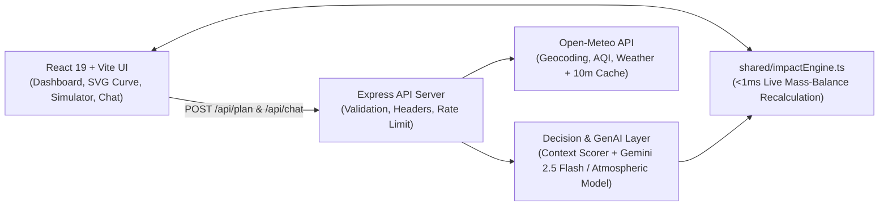

<div align="center">

# 🌫️ AirKin

**GenAI-Powered Winter Smog & Clean-Air Assistant for Families and Communities**

[](https://www.typescriptlang.org/)
[](https://react.dev/)
[](https://ai.google.dev/)
[](#testing--verification)
[](#repository-hygiene)

*Navigate severe winter smog with low-emission daily routines, budget-realistic indoor air quality hacks, sustainable alternatives, and transparent calculations showing the direct impact of every choice.*

</div>

---

## 🎯 Chosen Vertical

**Severe Winter Smog & Urban Air Pollution — Family & Community Clean-Air Assistant**

AirKin (*Air + Kin*) is tailored around two real-world personas facing seasonal winter particulate traps:

| Persona Mode | Who It Serves | Core Decisions Supported |
| :--- | :--- | :--- |
| **Family Household** | Parents, caregivers, seniors, and asthma/COPD households | Safe airing hours, bedroom clean-room filtration (`HEPA` / DIY `Corsi-Rosenthal`), school-run masking, cooking/heating swaps |
| **Community Organizer** | Neighborhood blocks, resident associations, school coordinators | Shareable daily clean-air briefings, school-gate no-idling pledges, zero evening leaf/waste burning, 100-home block impact tracking |

---

## 🧠 Approach and Logic

Winter urban smog behaves very differently from summer air pollution: **nocturnal and morning thermal inversions** trap cold, dense air and combustion plumes (traffic cold-starts, solid-fuel heating, open burning) near ground level until midday solar warming breaks the inversion layer.

AirKin pairs **real-time atmospheric physics** with **context-scored decision making**:

### 1. Live Atmospheric & Inversion Analytics (`server/airQualityService.ts`)
- Geocodes any city worldwide via Open-Meteo and fetches live `PM2.5`, `PM10`, `NO2`, `CO`, `SO2`, `O3`, `US AQI`, `European AQI`, temperature, humidity, and wind speed (cached in-memory with a 10-minute bounded TTL, with calibrated offline winter-city profiles if external APIs are unreachable).
- Computes a **Winter Thermal Inversion Trap Score (`0–100`)** combining wind stagnation, cold temperatures, relative humidity, and `PM2.5` load.
- Scans the 24-hour diurnal curve (`findVentilationWindow`) to pinpoint the **safest afternoon cross-ventilation window** and **peak inversion danger hour**.

### 2. Indoor Mass-Balance & Emission Impact Engine (`shared/impactEngine.ts`)
Every recommendation and toggle is backed by transparent physical accounting shared identically between the backend and the live `<1ms` frontend simulator:

```text
Indoor PM2.5 = (Outdoor_PM2.5 × Envelope_Infiltration + Remaining_Indoor_Sources) × Purifier_Factor × Intervention_Attenuation
```

- **Personal Health Impact**: Computes before/after indoor `PM2.5` (`µg/m³`) against the **WHO 24h guideline (`15 µg/m³`)**, daily household inhaled `PM2.5` avoided (`µg/day` and `%`), and weekly cigarette-equivalents avoided per person.
- **Community & Climate Impact**: Computes weekly primary `PM2.5` avoided (`g/week`), `CO2e` prevented (`kg/week` and 14-week winter total), and a **Community Block Multiplier** (`25` homes in Family Mode / `100` homes in Community Mode).

### 3. Context-Scored GenAI Synthesis (`server/advisorService.ts`)
- Ranks all interventions dynamically (`scoreInterventionsForContext`) using household vulnerabilities (children, seniors, respiratory conditions), budget tier (`zero_cost`, `low_budget`, `flexible`), commute mode/distance, heating/cooking fuels, and live inversion severity.
- **Server-Side Generative Mode**: When `GEMINI_API_KEY` is configured on the server (`.env`), uses `@google/genai` (`gemini-2.5-flash`) with strict JSON schema output grounded in live AQI and mass-balance metrics.
- **Zero-BYOK Deterministic Atmospheric Model**: When no server key is set, automatically runs the multi-factor priority scorer and domain topic composer grounded in live metrics—never asking users for API keys in the browser.

---

## ⚙️ How the Solution Works



### Core Capabilities
- **Live City AQI & 24-Hour Smog Curve**: Interactive SVG chart marking the WHO `15 µg/m³` target, thermal inversion peaks, and the optimal afternoon airing slot.
- **Interactive Choice & Direct Impact Simulator**: Toggle 8 evidence-based interventions (timed ventilation, draft sealing + damp mopping, DIY `Corsi-Rosenthal` MERV-13 box, clean cooking + zero incense, `N95/KF94` off-peak commute, transit/carpool swaps, zero-smoke electric heating, and school no-idle / no-burn pacts) with real-time impact bars and mechanistic *"Why it works"* explanations.
- **4-Pillar Tailored Action Plan + 1-Click Community Share**: Generates structured guidance across *Low-Emission Daily Routines*, *Indoor Air Quality Hacks*, *Sustainable Alternatives*, and *Community Multiplier*, plus a copyable neighborhood alert briefing.
- **Context-Aware AI Coach Chat**: Multi-turn conversational advisor grounded in the user's live city AQI and household profile.

### API Endpoints

| Endpoint | Method | Purpose |
| :--- | :--- | :--- |
| `/api/health` | `GET` | Server readiness & active model status (never exposes secrets) |
| `/api/presets` | `GET` | Winter smog hotspot cities and full intervention catalog |
| `/api/air-quality?city=...` | `GET` | Live/cached AQI, inversion risk score, hourly curve, and ventilation window |
| `/api/impact/calculate` | `POST` | Computes indoor `PM2.5`, inhaled dose saved, and emission reductions |
| `/api/plan` | `POST` | Returns live AQI + 4-pillar tailored plan with quantified impact explanations |
| `/api/chat` | `POST` | Context-grounded multi-turn conversational clean-air coaching |

---

## 📁 Project Structure

```text
├── shared/
│   ├── types.ts                 # Shared TypeScript domain contracts
│   └── impactEngine.ts          # Mass-balance, inversion risk, ventilation window & impact engine
├── server/
│   ├── index.ts                 # Express server, security headers, rate limiting & API routes
│   ├── airQualityService.ts     # Open-Meteo geocoding/AQI/weather client + 10m TTL cache + presets
│   ├── advisorService.ts        # Context scorer, Gemini 2.5 Flash integration & deterministic engine
│   └── validation.ts            # Strict input sanitization & schema clamping
├── src/
│   ├── App.tsx                  # Main dashboard & state orchestration
│   ├── components/
│   │   ├── SmogChart.tsx        # Accessible 24-hour PM2.5 & ventilation window SVG chart
│   │   ├── ProfilePanel.tsx     # Household & community persona customizer
│   │   ├── ImpactSimulator.tsx  # Interactive habit/swap toggles & live impact meters
│   │   ├── PlanCards.tsx        # 4-pillar tailored recommendations + community briefing copy
│   │   └── AdvisorChat.tsx      # Safe Markdown-free-of-XSS multi-turn AI coach UI
├── tests/
│   ├── impactEngine.test.ts     # Unit tests for AQI, inversion, ventilation & mass-balance math
│   └── serverApi.test.ts        # Integration tests for Express routes, validation & decision engine
└── README.md
```

---

## 📐 Assumptions Made

| Parameter / Model | Assumption Used | Basis |
| :--- | :--- | :--- |
| **Envelope Infiltration Factor** | `0.78` (drafty), `0.62` (average), `0.45` (well-sealed) | Typical residential winter PM2.5 penetration ratios |
| **Indoor Combustion Baseline** | `+26 µg/m³` (biomass/kerosene), `+14 µg/m³` (gas stove), `+30 µg/m³` (wood/coal heating) | Continuous daily-average equivalent indoor source additions |
| **Daily Breathing Volume** | `13.8 m³/day` (`11.2` indoor + `2.6` outdoor); `15.0 m³/day` with outdoor exercise | Standard adult/household average minute-ventilation split |
| **Cigarette Equivalence** | `22 µg/m³` 24-hour `PM2.5` exposure ≈ `1` cigarette/day | Berkeley Earth PM2.5 health-communication benchmark |
| **Winter Smog Season** | `14 weeks` per winter season | Used for seasonal `CO2e` and community block projections |
| **External API Resilience** | Calibrated offline city profiles (`Lahore`, `Delhi`, `Beijing`, etc.) | Fallback when Open-Meteo is unreachable or offline |

---

## 🚀 Quick Start

### Prerequisites
- **Node.js** `>= 20` and **npm**

### Local Development
```bash
git clone https://github.com/sachinn-alt/Airkin.git
cd Airkin
npm install
cp .env.example .env
# Optional: set GEMINI_API_KEY in .env on the server to enable Gemini 2.5 Flash
npm run dev
```
- Frontend: `http://localhost:5173`
- Backend API: `http://localhost:3001`

### Production Build
```bash
npm run build
npm start
```

---

## 🧪 Testing & Verification

```bash
npx tsc --noEmit
npm test
```
- **11/11 automated tests passing** across `tests/impactEngine.test.ts` and `tests/serverApi.test.ts`, validating AQI severity tiers, inversion risk scoring, ventilation window detection, indoor exposure reduction math, community scaling, input sanitization, and live Express API routes.

---

## 🛡️ Evaluation Focus Areas

- **Code Quality**: Clean separation across `shared/`, `server/`, `src/components/`, and `tests/`, with strict TypeScript (`strict: true`, `noUnusedLocals`, `noUnusedParameters`).
- **Security**: Server-side-only `GEMINI_API_KEY` (zero BYOK or client key handling), strict validation/clamping, security response headers, `100kb` JSON cap, per-IP rate limiting on AI endpoints, and React-native text rendering with zero `dangerouslySetInnerHTML`.
- **Efficiency**: 10-minute bounded TTL cache for external weather/AQI calls and instant `<1ms` shared client-side impact simulation.
- **Accessibility**: Semantic landmarks, keyboard skip link, `aria-live` updates, `aria-pressed` stateful controls, icon + text + color severity indicators, visible focus rings, and `prefers-reduced-motion` support.
- **Repository Hygiene**: Single branch (`main`), clean `.gitignore`, total tracked size `< 1 MB`.
