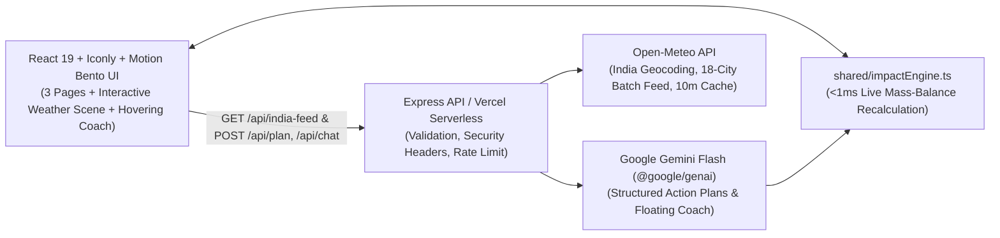

<div align="center">

# 🌫️ AirKin

**GenAI-Powered All-India Winter Smog & Clean-Air Assistant for Families and Communities**

[](https://airkin.vercel.app/)
[](https://www.typescriptlang.org/)
[](https://react.dev/)
[](https://ai.google.dev/)
[](#testing--verification)
[](#testing--verification)
[](#evaluation-focus-areas)

*Navigate severe Indian winter smog with low-emission daily routines, budget-realistic indoor air quality hacks, sustainable alternatives, an interactive atmospheric visual scene, an 18-city All-India live feed, and transparent physics-backed impact math.*

</div>

---

## 🎯 Chosen Vertical

**Severe Winter Smog & Urban Air Pollution (India) — Family & Community Clean-Air Assistant**

AirKin (*Air + Kin*) is tailored around two real-world personas navigating seasonal winter particulate traps across Indian cities:

| Persona Mode | Who It Serves | Core Decisions Supported |
| :--- | :--- | :--- |
| **Family Household** | Parents, caregivers, seniors, and asthma/COPD households | Safe airing hours, bedroom clean-room filtration (`HEPA` / DIY `Corsi-Rosenthal`), school-run masking, cooking/heating swaps |
| **Community Organizer** | Resident Welfare Associations (RWAs), neighborhood blocks, school coordinators | 1-click WhatsApp/RWA clean-air alerts, school-gate no-idling pledges, zero evening leaf/waste burning, 10–250 home block impact scaling |

---

## 🧠 Approach and Logic

Winter urban smog in Indian cities behaves very differently from summer pollution: **nocturnal and morning thermal inversions** trap cold, dense air and combustion plumes (traffic cold-starts, solid-fuel heating, open burning) near street level until midday solar warming lifts the boundary layer.

AirKin separates **quantitative atmospheric/indoor physics** from **GenAI reasoning** so every recommendation is empathetic, visual, and mathematically grounded:

### 1. All-India Live Atmospheric & Weather Analytics (`server/airQualityService.ts`)
- **Indian City Geocoding (`countryCode=IN`)**: Searches any Indian city via Open-Meteo and fetches live `PM2.5`, `PM10`, `NO2`, `CO`, `SO2`, `O3`, `US AQI`, `European AQI`, temperature, humidity, wind speed, and WMO weather conditions (cached 10 minutes in-memory, with calibrated offline presets if external APIs are unreachable).
- **All-India 18-City Live Feed (`GET /api/india-feed`)**: Batches live AQI and weather telemetry across **North, West, East, Central, and South India** (`Delhi`, `Gurugram`, `Noida`, `Lucknow`, `Kanpur`, `Patna`, `Chandigarh`, `Jaipur`, `Kolkata`, `Bhubaneswar`, `Guwahati`, `Mumbai`, `Pune`, `Ahmedabad`, `Bhopal`, `Bengaluru`, `Hyderabad`, `Chennai`) in two batched Open-Meteo requests.
- **Thermal Inversion & Safe Airing Detection**: Computes a **Winter Thermal Inversion Trap Score (`0–100`)** and scans the 24-hour curve (`findVentilationWindow`) to pinpoint the safest afternoon cross-ventilation slot and peak smog hour.

### 2. Indoor Mass-Balance & Emission Impact Engine (`shared/impactEngine.ts`)
Every toggle in the Impact Simulator and every grounding prompt sent to Gemini uses transparent physical accounting:

```text
Indoor PM2.5 = (Outdoor_PM2.5 × Envelope_Infiltration + Remaining_Indoor_Sources) × Purifier_Factor × Intervention_Attenuation
```

- **Personal Health Impact**: Computes before/after indoor `PM2.5` (`µg/m³`) against the **WHO 24h guideline (`15 µg/m³`)**, daily household inhaled `PM2.5` avoided (`µg/day` and `%`), and weekly cigarette-equivalents avoided per person.
- **Community & Climate Impact**: Computes weekly primary `PM2.5` avoided (`g/week`), `CO2e` prevented (`kg/week` and 14-week winter total), and an interactive **Community Block Multiplier** (`10–250` homes).

### 3. Server-Side GenAI Synthesis (`server/advisorService.ts`)
- Ranks physical interventions dynamically (`scoreInterventionsForContext`) using household vulnerabilities, budget tier, commute distance, heating/cooking fuels, and live inversion severity.
- Calls **Google Gemini Flash** (`gemini-3.5-flash-lite` primary with automatic multi-model failover across `gemini-3.5-flash`, `gemini-3.6-flash`, and `gemini-3.7-flash` via `@google/genai`) using server-side `process.env.GEMINI_API_KEY` (zero BYOK or client-side key handling), strict JSON `responseSchema` for `/api/plan`, and multi-turn context for `/api/chat`.

---

## ⚙️ How the Solution Works



### Multi-Page Interactive Experience (Light Theme)
1. **Page 1 — Live Smog & Daily Plan**:
   - **Animated US AQI Ring Gauge** + live pollutant/weather tiles.
   - **Interactive Atmospheric Visual Scene** (`WeatherVisualScene.tsx`): Animated weather & particulate illustration with clickable `Outdoor`, `Inversion`, and `Sanctuary` inspection layers.
   - **Glitch-Free 24-Hour Smog Curve** (`SmogChart.tsx`): Fixed-height readout strip + smooth pointer/touch scrubbing marking the WHO `15 µg/m³` line and safe airing slot.
   - **All-India Live Weather & Smog Feed** (`IndiaLiveFeed.tsx`): Region filters (`North`, `West`, `East`, `Central`, `South`), AQI sorting, and 1-click city switching across 18 cities.
   - **4-Pillar Gemini Action Cards** (`PlanCards.tsx`): Interactive checkable steps and on-demand `Why` drawers.
2. **Page 2 — Household & Impact Simulator**:
   - Icon-driven household customizer (`Family` / `Community` mode, risk flags, filtration, fuels, commute distance, Indian ₹ budget tiers).
   - Live before/after indoor exposure bars, `10–250` home block multiplier slider, and 8 toggleable habits/hacks with expandable mechanism cards.
3. **Page 3 — Community & Guide**:
   - 1-click copyable **RWA & School-Group WhatsApp Briefing** tailored to the active Indian city.
   - Interactive **DIY Corsi-Rosenthal MERV-13 Build Checklist** with progress bar and collapsible model assumptions.
4. **Hovering `Ask AirKin Coach` Button** (`AdvisorChat.tsx`):
   - Floating bottom-right pill accessible on all 3 pages that opens a spring-animated Gemini coach dialog.

### API Endpoints

| Endpoint | Method | Purpose |
| :--- | :--- | :--- |
| `/api/health` | `GET` | Server readiness & `GEMINI_API_KEY` status (never exposes secrets) |
| `/api/india-feed` | `GET` | Live batched AQI & weather feed for 18 cities across India (10m cache) |
| `/api/presets` | `GET` | Indian winter hotspot presets and full intervention catalog |
| `/api/air-quality?city=...` | `GET` | Live/cached Indian city AQI, weather condition, inversion risk & hourly curve (`400` if non-Indian) |
| `/api/impact/calculate` | `POST` | Computes indoor `PM2.5`, inhaled dose saved, and emission reductions |
| `/api/plan` | `POST` | Returns live AQI + Gemini Flash 4-pillar tailored plan (`503` if server key unset) |
| `/api/chat` | `POST` | Grounded multi-turn conversational coaching via Gemini Flash |

---

## 📁 Project Structure

```text
├── api/
│   └── index.ts                             # Vercel serverless Express entrypoint
├── shared/
│   ├── types.ts                             # Shared TypeScript domain contracts
│   └── impactEngine.ts                      # Mass-balance, inversion risk, ventilation window & impact engine
├── server/
│   ├── index.ts                             # Express server, security headers, rate limiting & API routes
│   ├── airQualityService.ts                 # India geocoding, 18-city live batch feed, 10m TTL cache
│   ├── advisorService.ts                    # Context grounding & Google Gemini multi-model retry client
│   └── validation.ts                        # Strict input sanitization & schema clamping
├── src/
│   ├── App.tsx                              # 3-page Motion shell, header, and state orchestration
│   └── components/
│       ├── ui/AceternityPrimitives.tsx      # SpotlightCard, AnimatedCounter & AqiGaugeRing
│       ├── WeatherVisualScene.tsx           # Interactive animated weather & inversion SVG scene
│       ├── IndiaLiveFeed.tsx                # 18-city All-India live feed with region & sort filters
│       ├── SmogChart.tsx                    # Glitch-free 24h PM2.5 curve with fixed readout strip
│       ├── ProfilePanel.tsx                 # Household & community persona customizer
│       ├── ImpactSimulator.tsx              # Interactive habit toggles, live bars & block slider
│       ├── PlanCards.tsx                    # 4-pillar Gemini Bento cards with checkable steps
│       ├── CommunityGuide.tsx               # RWA alert generator, DIY MERV-13 checklist & assumptions
│       └── AdvisorChat.tsx                  # Hovering floating Ask AirKin Coach button & dialog
├── tests/
│   ├── impactEngine.test.ts                 # Unit tests for AQI, inversion, ventilation & mass-balance math
│   └── serverApi.test.ts                    # Integration tests for Express routes, India feed & mocked Gemini
├── e2e/
│   └── airkin.spec.ts                       # Playwright Chromium end-to-end verification suite
├── vercel.json                              # Vercel build & /api rewrite rules
├── vitest.config.ts                         # Vitest unit/API test config
├── playwright.config.ts                     # Playwright E2E test config
└── README.md
```

---

## 📐 Assumptions Made

| Parameter / Model | Assumption Used | Basis |
| :--- | :--- | :--- |
| **Envelope Infiltration Factor** | `0.78` (drafty), `0.62` (average), `0.45` (well-sealed) | Typical residential winter PM2.5 penetration ratios |
| **Indoor Combustion Baseline** | `+26 µg/m³` (biomass/kerosene), `+14 µg/m³` (gas stove), `+30 µg/m³` (wood/coal heating) | Continuous daily-average equivalent indoor source additions |
| **Daily Breathing Volume** | `13.8 m³/day` (`11.2` indoor + `2.6` outdoor); `15.0 m³/day` with outdoor exercise | Standard adult/household average minute-ventilation split |
| **Cigarette Equivalence** | `22 µg/m³` 24-hour `PM2.5` exposure ≈ `1` cigarette/day | Berkeley Earth PM2.5 health-communication benchmark |
| **Winter Smog Season** | `14 weeks` per winter season | Used for seasonal `CO2e` and community block projections |
| **Geographic Scope** | Indian cities (`countryCode=IN`) with 18 calibrated regional presets | Ensures relevant Indian winter smog telemetry & advisories |

---

## 🚀 Quick Start

### Prerequisites
- **Node.js** `>= 20` and **npm**
- A Google AI Studio **`GEMINI_API_KEY`** configured in server `.env`

### Local Development
```bash
git clone https://github.com/sachinn-alt/Airkin.git
cd Airkin
npm install
cp .env.example .env
# Add GEMINI_API_KEY=your_key_here inside .env
npm run dev
```
- Frontend: `http://localhost:5173`
- Backend API: `http://localhost:3001`

### Production Build
```bash
npm run build
npm start
```

---

## 🧪 Testing & Verification

```bash
npx tsc --noEmit
npm test
npm run build
npm run test:e2e
```
- **Vitest (`13/13` passing)**: `tests/impactEngine.test.ts` (5 tests) and `tests/serverApi.test.ts` (8 tests) validating AQI tiers, inversion risk, ventilation windows, mass-balance math, Indian-only presets, `/api/india-feed`, input clamping, `503` unconfigured key handling, and Gemini API flows.
- **Playwright E2E (`1/1` passing locally & against `https://airkin.vercel.app/`)**: Verifies all 3 pages, live weather scene layers, 18-city India feed filtering/switching, glitch-free chart pointer scrubbing (`<2px` layout delta), simulator toggles, hovering `Ask AirKin Coach` Gemini chat, zero BYOK inputs, and zero console/page errors.

---

## 🛡️ Evaluation Focus Areas

- **Code Quality**: Modular TypeScript across `shared/`, `server/`, `src/components/`, and `tests/` (`strict: true`, `noUnusedLocals`, `noUnusedParameters`).
- **Security**: Server-side-only `GEMINI_API_KEY` (zero BYOK or client key handling), strict validation/clamping, security response headers, `100kb` JSON cap, per-IP rate limiting, and React-native text rendering with zero `dangerouslySetInnerHTML`.
- **Efficiency**: Batched 18-city Open-Meteo requests with 10-minute bounded TTL caching and `<1ms` shared client-side impact simulation.
- **Accessibility**: Semantic landmarks, skip link, `aria-live` announcements, `aria-pressed` / `aria-current="page"` controls, icon + text + color severity badges, visible focus rings, and `prefers-reduced-motion` support.
- **Repository Hygiene**: Single branch (`main`), clean `.gitignore`, total tracked size `< 1 MB`.
