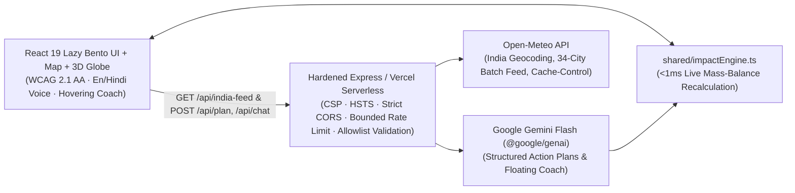

<div align="center">

# 🌫️ AirKin

**GenAI-Powered All-India Winter Smog & Clean-Air Assistant for Families and Communities**

[](https://airkin.vercel.app/)
[](https://www.typescriptlang.org/)
[](https://react.dev/)
[](https://ai.google.dev/)
[](#testing--verification)
[](#testing--verification)
[](#evaluation-focus-areas)

*Navigate severe Indian winter smog with low-emission daily routines, budget-realistic indoor air quality hacks, sustainable swaps, an interactive India CPCB map (including Jammu & Kashmir and Ladakh), a 3D atmospheric corridor globe, live meteorology cards, bilingual EN/हिंदी RWA alerts with voice read-aloud, and physics-backed impact math.*

</div>

---

## 🎯 Chosen Vertical

**Severe Winter Smog & Urban Air Pollution (India) — Family & Community Clean-Air Assistant**

AirKin (*Air + Kin*) is tailored around two real-world personas navigating seasonal winter particulate traps across Indian cities:

| Persona Mode | Who It Serves | Core Decisions Supported |
| :--- | :--- | :--- |
| **Family Household** | Parents, caregivers, seniors, and asthma/COPD households | Safe airing hours, school-run & commute hour exposure timing, bedroom filtration (`HEPA` / DIY `Corsi-Rosenthal`), cooking/heating swaps |
| **Community Organizer** | Resident Welfare Associations (RWAs), neighborhood blocks, school coordinators | 1-click English & **हिंदी** WhatsApp/RWA alerts with audio read-aloud, school-gate no-idling pledges, zero evening leaf/waste burning, 10–250 home scaling |

---

## 🧠 Approach and Logic

Winter urban smog in Indian cities behaves differently from summer pollution: **nocturnal and morning thermal inversions** trap cold, dense air and combustion plumes near street level until midday solar mixing lifts the boundary layer.

AirKin separates **quantitative atmospheric/indoor physics** from **GenAI reasoning** so every recommendation is empathetic, visual, and mathematically grounded:

### 1. All-India Live Atmospheric & CPCB NAQI Analytics (`server/airQualityService.ts`)
- **Indian City Geocoding (`countryCode=IN`)**: Fetches live `PM2.5`, `PM10`, `NO2`, `CO`, `SO2`, `O3`, **Official India CPCB NAQI** (`Good`, `Satisfactory`, `Moderate`, `Poor`, `Very Poor`, `Severe`), US AQI, temperature, humidity, wind speed, and WMO conditions (cached 10 minutes in-memory with bounded eviction, plus calibrated regional presets).
- **All-India 34-City Live Feed (`GET /api/india-feed`)**: Batches live AQI and weather telemetry across **North, West, East, Central, and South India** — including **Srinagar**, **Jammu**, and **Leh** across Jammu & Kashmir and Ladakh alongside Delhi NCR, Lucknow, Patna, Kolkata, Mumbai, Bengaluru, Chennai, Hyderabad, and Guwahati.
- **Thermal Inversion & Safe Airing Detection**: Computes a **Winter Thermal Inversion Trap Score (`0–100`)** and scans the 24-hour curve (`findVentilationWindow`) to pinpoint the safest afternoon airing slot and peak smog hour.

### 2. Indoor Mass-Balance & Emission Impact Engine (`shared/impactEngine.ts`)
Every toggle in the Impact Simulator and every grounding prompt sent to Gemini uses transparent physical accounting:

```text
Indoor PM2.5 = (Outdoor_PM2.5 × Envelope_Infiltration + Remaining_Indoor_Sources) × Purifier_Factor × Intervention_Attenuation
```

- **Personal Health Impact**: Computes before/after indoor `PM2.5` (`µg/m³`) against the **WHO 24h guideline (`15 µg/m³`)**, daily household inhaled `PM2.5` avoided (`µg/day` and `%`), weekly cigarette-equivalents avoided, and an interactive **Commute & School-Run Hour Exposure** slider.
- **Community & Climate Impact**: Computes weekly primary `PM2.5` avoided (`g/week`), `CO2e` prevented (`kg/week` and 14-week winter total), and an interactive **Community Block Multiplier** (`10–250` homes).

### 3. Server-Side GenAI Synthesis (`server/advisorService.ts`)
- Ranks physical interventions dynamically (`scoreInterventionsForContext`) using household vulnerabilities, budget tier, commute distance, heating/cooking fuels, and live inversion severity.
- Calls **Google Gemini Flash** (`gemini-3.5-flash-lite` primary with automatic multi-model failover across `gemini-3.5-flash`, `gemini-3.6-flash`, and `gemini-3.7-flash` via `@google/genai`) using server-side `process.env.GEMINI_API_KEY` (zero BYOK or client-side key handling), strict JSON `responseSchema` for `/api/plan`, and multi-turn context for `/api/chat`.

---

## ⚙️ How the Solution Works



### Multi-Page Interactive Experience (Daylight Palette)
1. **Page 1 — Live Smog & Daily Plan**:
   - **Animated CPCB NAQI Ring Gauge** + live pollutant/weather tiles & thermal inversion cap bar.
   - **Interactive Atmospheric Visual Scene** (`WeatherVisualScene.tsx`): Animated weather & particulate illustration with `Outdoor`, `Inversion`, and `Sanctuary` inspection layers.
   - **Glitch-Free 24-Hour Smog Curve** (`SmogChart.tsx`): Fixed-height readout strip + smooth pointer/keyboard (`ArrowLeft`/`ArrowRight`) scrubbing marking the WHO `15 µg/m³` line and safe airing slot.
   - **All-India 34-City Live Map, 3D Globe & Tile Grid** (`IndiaLiveFeed.tsx`, `IndiaAqiMap.tsx`, `route-globe.tsx`): Interactive India SVG map (composite Survey of India/DataMeet geometry including Jammu & Kashmir and Ladakh) with keyboard-focusable CPCB color-coded pins, lazy-loaded interactive 3D atmospheric `RouteGlobe`, and region/AQI filters.
   - **Live Meteorology `WeatherCard` & 4-Pillar Gemini Action Cards** (`weather-card.tsx`, `PlanCards.tsx`): Current conditions, hourly temperature strip, multi-day range scale, checkable action steps, and on-demand `Why` science drawers.
2. **Page 2 — Household & Impact Simulator**:
   - Icon-driven household customizer (`Family` / `Community` mode, risk flags, filtration, fuels, commute distance, Indian ₹ budget tiers).
   - Live before/after indoor exposure bars, `10–250` home block multiplier slider, **Commute & School-Run Hour Exposure** slider, and 8 toggleable habits/hacks with expandable mechanism drawers.
3. **Page 3 — Community & Guide**:
   - 1-click copyable **EN / हिंदी RWA & School-Group Clean-Air Briefing** with **1-click audio read-aloud (`en-IN` / `hi-IN`)** tailored to the active Indian city.
   - Interactive **DIY Corsi-Rosenthal MERV-13 Build Checklist** with progress bar and collapsible model assumptions.
4. **Hovering `Ask AirKin Coach` Button** (`AdvisorChat.tsx`) & **Editorial Misty-Hills Footer** (`Footer.tsx`).

### API Endpoints

| Endpoint | Method | Purpose |
| :--- | :--- | :--- |
| `/api/health` | `GET` | Server readiness & `GEMINI_API_KEY` status (`no-store`, zero secret leakage) |
| `/api/india-feed` | `GET` | Live batched CPCB NAQI & weather feed for 34 cities across India (cached) |
| `/api/presets` | `GET` | Indian winter hotspot presets and allowlisted intervention catalog |
| `/api/air-quality?city=...` | `GET` | Live/cached Indian city AQI, weather condition, inversion risk & hourly curve |
| `/api/impact/calculate` | `POST` | Computes indoor `PM2.5`, inhaled dose saved, and emission reductions |
| `/api/plan` | `POST` | Returns live AQI + Gemini Flash 4-pillar tailored plan (`503` if server key unset) |
| `/api/chat` | `POST` | Grounded multi-turn conversational coaching via Gemini Flash |

---

## 📁 Project Structure

```text
├── api/index.ts                             # Vercel serverless Express entrypoint
├── public/favicon.svg                       # Minimal teal leaf-and-breeze AirKin SVG favicon
├── shared/
│   ├── types.ts                             # Shared TypeScript domain contracts
│   └── impactEngine.ts                      # Mass-balance, CPCB NAQI, inversion & impact engine
├── server/
│   ├── index.ts                             # Hardened Express server, security headers, CORS, rate limit
│   ├── airQualityService.ts                 # India geocoding, 34-city live batch feed, bounded cache
│   ├── advisorService.ts                    # Context grounding & Google Gemini multi-model retry client
│   └── validation.ts                        # Allowlisted action IDs, clamping & strict sanitization
├── src/
│   ├── App.tsx                              # 3-page lazy-loaded Motion shell & single-row pill header
│   ├── lib/
│   │   ├── utils.ts                         # Shared Tailwind class merge utility (cn)
│   │   └── weatherMapper.ts                 # Live Open-Meteo -> WeatherCard data adapter
│   ├── data/indiaOutline.ts                 # Composite India GeoJSON polygons (incl. J&K and Ladakh)
│   └── components/
│       ├── ui/                              # AirKinMark, SpotlightCard, RouteGlobe, WeatherCard
│       ├── AmbientWeatherBackdrop.tsx       # Illustrated alpine valley & atmospheric horizon backdrop
│       ├── WeatherVisualScene.tsx           # Interactive outdoor / inversion / sanctuary SVG scene
│       ├── IndiaAqiMap.tsx                  # Keyboard-accessible CPCB color-coded India SVG map
│       ├── IndiaLiveFeed.tsx                # Map + Grid, Map, 3D Globe & Grid views (34 cities)
│       ├── SmogChart.tsx                    # Glitch-free 24h PM2.5 curve with arrow/pointer scrub
│       ├── ProfilePanel.tsx                 # Household & community persona customizer
│       ├── ImpactSimulator.tsx              # Habit toggles, block multiplier & commute hour slider
│       ├── PlanCards.tsx                    # 4-pillar Gemini cards with checkable steps & Why drawer
│       ├── CommunityGuide.tsx               # EN / हिंदी WhatsApp alerts, voice read-aloud & DIY checklist
│       ├── AdvisorChat.tsx                  # Hovering floating Ask AirKin Coach dialog
│       └── Footer.tsx                       # Editorial rolling-hills footer with quick navigation
├── tests/                                   # Vitest unit, validation, API/security & React DOM tests
└── e2e/airkin.spec.ts                       # Playwright E2E + @axe-core/playwright WCAG AA suite
```

---

## 🚀 Quick Start

```bash
git clone https://github.com/sachinn-alt/Airkin.git
cd Airkin
npm install
cp .env.example .env
# Add GEMINI_API_KEY=your_key_here inside .env
npm run dev
```

---

## 🧪 Testing & Verification

```bash
npm run lint           # Strict TypeScript (tsc --noEmit)
npm run test:coverage  # Vitest unit, API/security & React DOM suite + V8 coverage
npm run build          # Chunk-split Vite production bundle + server TypeScript build
npm run test:e2e       # Playwright Chromium E2E + automated @axe-core/playwright WCAG 2.1 AA audit
```

---

## 🛡️ Evaluation Focus Areas

- **Code Quality**: Strict TypeScript (`strict: true`, `noUnusedLocals`, `noUnusedParameters`), cleanly separated `shared/`, `server/`, `src/lib/`, and `src/components/` layers with explicit JSDoc documentation and zero duplicate helpers.
- **Security**: `X-Powered-By` disabled, `Content-Security-Policy`, `X-Frame-Options: DENY`, `X-Content-Type-Options: nosniff`, `Cross-Origin-Opener-Policy`, `Cross-Origin-Resource-Policy`, `Strict-Transport-Security`, origin-validated CORS, bounded rate limiting (`X-RateLimit-*`), `100kb` JSON cap, catalog-allowlisted action ID validation, and server-side-only `GEMINI_API_KEY`.
- **Efficiency**: Route/page & 3D Globe lazy code splitting (`React.lazy` + `Suspense`), separated vendor chunks (`vite.config.ts`), HTTP `Cache-Control` headers, 10-minute batched 34-city Open-Meteo cache, and `<1ms` client-side impact simulation.
- **Testing**: `30` Vitest unit, validation, security header, geometry, and React Testing Library component tests with V8 coverage reporting plus Playwright Chromium E2E against both localhost and live Vercel.
- **Accessibility**: Verified zero critical/serious WCAG 2.1 Level A/AA violations via `@axe-core/playwright` across all 3 pages, keyboard-navigable SVG map pins (`Enter`/`Space`), English + Hindi audio read-aloud (`SpeechSynthesis`), `aria-valuetext` range sliders, high-contrast labels, `aria-live` updates, and `prefers-reduced-motion` support.
- **Repository Hygiene**: Single branch (`main`), clean `.gitignore`, total tracked size `< 1 MB`.
